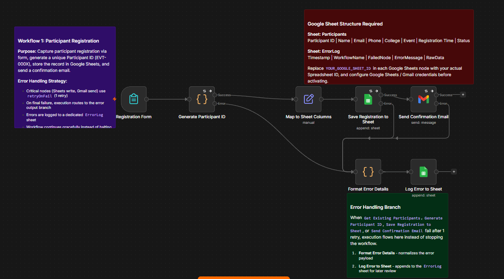
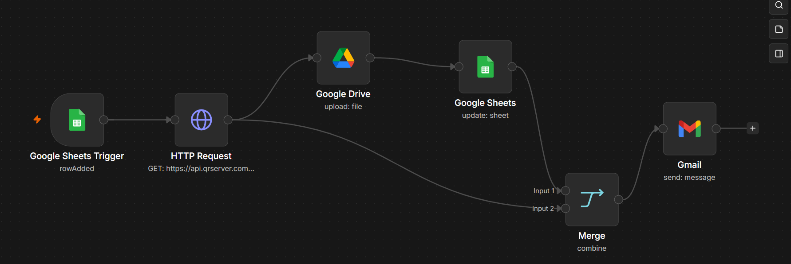

# 🎓 Smart Event Management Automation

An end-to-end event management and certificate distribution system built using
n8n and Google Workspace.

The system automates participant registration, QR code generation, attendance
tracking, personalized certificate creation, PDF generation, cloud storage,
and email delivery.

## 🚀 Features

- Participant registration through an automated form
- Automatic participant ID generation
- Registration data stored in Google Sheets
- Automatic QR code generation
- QR code storage in Google Drive
- QR-based participant check-in
- Automatic attendance status update
- Personalized certificate generation
- Google Slides certificate template integration
- Automatic PDF generation
- Certificate storage in Google Drive
- Automated certificate email delivery
- End-to-end workflow automation using n8n

## 🛠️ Tech Stack

- n8n
- Google Sheets
- Google Drive
- Google Slides
- Gmail
- Google Forms
- JavaScript
- QR Code API

## 🔄 Workflow

### 1. Participant Registration

Participant submits the registration form.

The workflow:
- Generates a unique participant ID
- Maps registration data
- Stores the participant in Google Sheets
- Sends a registration confirmation email

### 2. QR Code Generation

When a new participant is registered:

- n8n detects the new Google Sheets row
- Generates a QR code
- Uploads the QR code to Google Drive
- Stores the QR code URL in Google Sheets
- Sends the QR code to the participant by email

### 3. QR Check-in & Attendance

During the event:

- QR code is scanned
- Participant ID is sent to the check-in webhook
- Participant is searched in Google Sheets
- Attendance status is updated to `Present`

### 4. Certificate Distribution

When attendance is marked as `Present`:

- Certificate template is copied
- Participant details replace template placeholders
- Certificate is exported as PDF
- PDF is uploaded to Google Drive
- Certificate is shared
- Certificate is emailed to the participant
- Certificate status is updated in Google Sheets

## 📊 System Flow

Registration
↓
Google Sheets
↓
QR Code Generation
↓
QR Code Check-in
↓
Attendance = Present
↓
Certificate Generation
↓
PDF Storage
↓
Email Delivery

## 📸 Screenshots

### Workflow 1 — Participant Registration



### Workflow 2 — QR Code Generation



### Workflow 3 — QR Check-in & Attendance


### Workflow 4 — Certificate Distribution


### Generated QR Code


### Generated Certificate


### Automated Email


## 📁 Repository Structure

```text
workflows/
├── workflow-1-registration.json
├── workflow-2-qr-generation.json
├── workflow-3-attendance.json
└── workflow-4-certificate.json

screenshots/
├── workflow-1-registration.png
├── workflow-2-qr-generation.png
├── workflow-3-attendance.png
├── workflow-4-certificate.png
├── qr-code.png
├── certificate.png
└── email.png